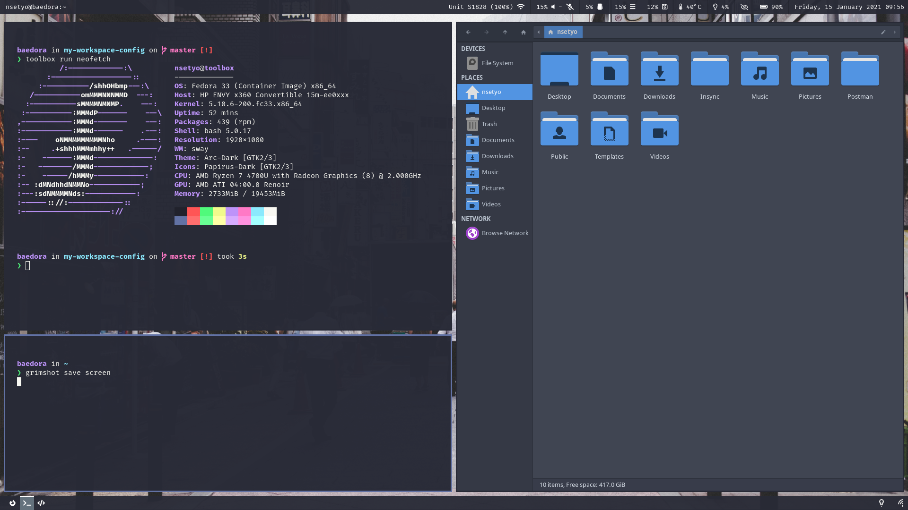

### My Daily Workspace Configuration




### Configurations
- **OS**: [Arch Linux](https://archlinux.org/)
- **Terminal**: [Kitty](https://sw.kovidgoyal.net/kitty/)
- **Shell**: Bash with [Starship](https://starship.rs/)
- **WM**: [Hyprland](https://hyprland.org/) (konfigurasi Lua, layout scrolling di workspace 1)
- **Panel**: [Quickshell](https://quickshell.org/)
- **Launcher**: [Rofi](https://github.com/davatorium/rofi)
- **Screenlock**: [hyprlock](https://github.com/hyprwm/hyprlock) (grace 5 detik)
- **Gtk Theme**: [Catppuccin Mocha](https://github.com/catppuccin/catppuccin)
- **Icons**: [Papirus](https://github.com/PapirusDevelopmentTeam/papirus-icon-theme)
- **Fonts**: [Fira Code](https://github.com/tonsky/FiraCode)


#### Requirements
Hyprland >= 0.55 (konfigurasi Lua diperkenalkan di 0.55; layout scrolling masuk core sejak 0.54). Quickshell dari repo resmi Arch.

```sh
sudo pacman -S hyprland hyprlock hypridle hyprpaper \
  quickshell \
  rofi kitty grim slurp mako brightnessctl playerctl \
  networkmanager gammastep starship stow git
```

### Installation
Dotfiles are grouped into [GNU Stow](https://www.gnu.org/software/stow/) packages under `packages/`. Stow itself is a requirement.

```sh
git clone git@github.com:nsetyo/dotfiles.git
cd dotfiles
./install               # stow every package into $HOME
./install hypr kitty    # stow only the named packages
./install -n hypr       # dry run
./install -D hypr       # unstow
```

`.stowrc` sets the target to `$HOME` and enables `--no-folding`, so only individual files are linked and apps can write runtime state into their config dirs without touching this repo.

Dash-prefixed arguments are passed to stow; write options that take a value as `--opt=value`. Existing non-symlink files at the target (e.g. `~/.config/starship.toml`) must be moved away first, or use `stow --adopt` to pull them into the repo.

System files in `etc/sysctl.d` are copied (not linked) with `scripts/install-sysctl.sh`; run `sudo sysctl --system` or reboot to apply them.

### Wallpaper
Wallpaper diambil dari Unsplash lewat script `wallpaper-rotate.sh` (`packages/hypr/.config/hypr/wallpaper-rotate.sh`) yang jalan tiap Hyprland start, jadi tiap sesi wallpaper-nya baru. Script ini butuh `UNSPLASH_ACCESS_KEY` di `~/.config/hypr/wallpaper.env` (file lokal, jangan di-commit; kunci dibuat di https://unsplash.com/developers). Kalau mau ganti wallpaper di tengah sesi, jalankan manual: `bash ~/.config/hypr/wallpaper-rotate.sh`.

Contoh wallpaper (Mount Fuji, Unsplash): 
