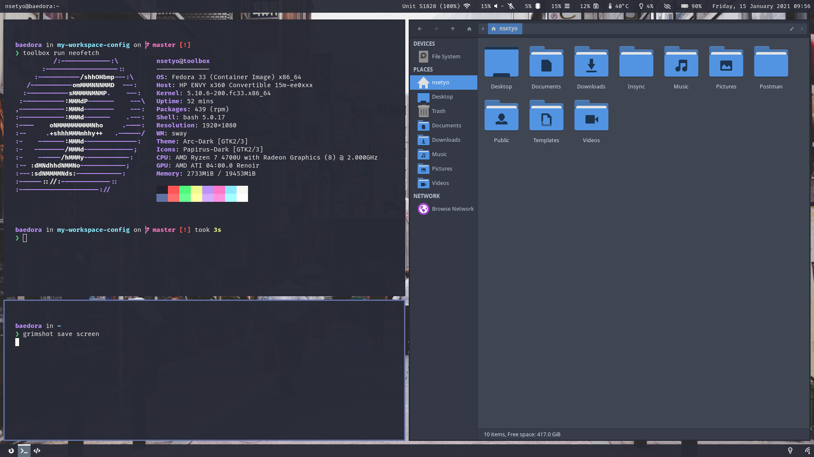

### My Daily Workspace Configuration




### Configurations
- **OS**: [Fedora](https://getfedora.org/)
- **Terminal**: [Kitty](https://sw.kovidgoyal.net/kitty/)
- **Shell**: Bash with [Starship](https://starship.rs/) 
- **WM**: [Sway](https://github.com/swaywm/sway)
- **Panel**: [Waybar](https://github.com/Alexays/Waybar)
- **Launcher**: [Wofi](https://hg.sr.ht/~scoopta/wofi)
- **Screenlock**: [Swaylock](https://github.com/swaywm/swaylock)
- **Gtk Theme**: [Arc-Dark [Gtk2/3]](https://github.com/horst3180/Arc-theme)
- **Icons**: [Papirus](https://github.com/PapirusDevelopmentTeam/papirus-icon-theme)
- **Fonts**: [Fira Code](https://github.com/tonsky/FiraCode)


#### Requirements
1. [Swayidle](https://github.com/swaywm/swayidle)
2. [Grim](https://wayland.emersion.fr/grim/)
3. [Mako](https://github.com/emersion/mako)
4. [Font Awesome 5](https://fontawesome.com/)
5. [Brightnessctl](https://github.com/Hummer12007/brightnessctl)
6. [Playerctl](https://github.com/altdesktop/playerctl)
7. [NetworkManager-tui](https://pkgs.org/download/networkmanager-tui)
8. [Gammastep](https://gitlab.com/chinstrap/gammastep)

### Installation
Dotfiles are grouped into [GNU Stow](https://www.gnu.org/software/stow/) packages under `packages/`. Stow itself is a requirement.

```sh
git clone git@github.com:nsetyo/dotfiles.git
cd dotfiles
./install            # stow every package into $HOME
./install sway waybar  # stow only the named packages
./install -n sway    # dry run (flags are passed to stow)
```

`.stowrc` sets the target to `$HOME` and enables `--no-folding`, so only individual files are linked and apps can write runtime state into their config dirs without touching this repo.

Remove a package with `stow -D <package>`. Existing non-symlink files at the target (e.g. `~/.config/starship.toml`) must be moved away first, or use `stow --adopt` to pull them into the repo.

System files in `etc/sysctl.d` are copied (not linked) with `scripts/install-sysctl.sh`.
